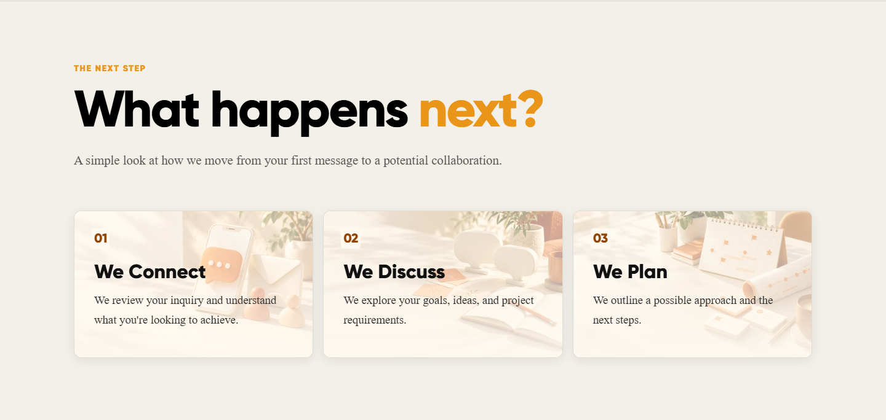
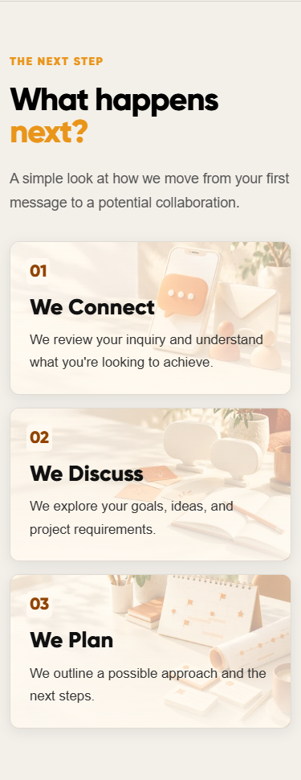

# Light Contact next-step images

Added three original AI-generated ivory/orange images to the Contact page's existing We Connect, We Discuss and We Plan cards. Subjects are first-contact messaging, collaborative discussion and a calendar/project roadmap. Existing text, card layout, form behavior and animations are retained. Started from main `019ef907201557f7f1e5c6e29f04e6934aa4cbac` on `feat/light-contact-card-images`.

The cards reuse `LightCardImage`, the existing pale overlays and dark copy. Their numbers use the same accessible darker orange and ivory backplate as the other light cards. Assets are local 480×320 and 960×640 WebP files, quality 80, with responsive sources, native lazy loading, async decoding and decorative image semantics. No new component or dependency was added. Images are absolute layers and cannot change card dimensions when loading.

| Image | 480px bytes | 960px bytes |
| --- | ---: | ---: |
| Connect | 9,548 | 23,212 |
| Discuss | 12,384 | 28,988 |
| Plan | 12,862 | 32,922 |
| Total | 34,794 | 85,122 |

The URL pairs are in `src/data/lightCardImages.js`; associations are in Contact's `nextSteps` data. Replace both sizes together while retaining pale backgrounds and subjects toward the right. Original PNGs are not shipped. Other light-card styles are unchanged except for adding the Contact number selector.

Validation on 14 October 2026:

- Build, lint and all eight existing tests passed.
- Production-preview Chrome checks passed at 320, 375, 390, 430, 768, 1024 and 1440px: seven route/width combinations, all 21 card checks passed. Images decoded, text remained in bounds, decorative semantics were present, and there was no horizontal overflow or captured browser error.
- Direct Contact load, refresh, reduced-motion rendering and normal reveal rendering passed.
- Empty contact-form submission showed validation and focused the first invalid field at 390 and 1440px. No enquiry was sent.
- All 27 card text bounding regions sampled at 320, 390 and 1440px passed a conservative 4.5:1 contrast threshold; minimum measured ratio was 6.44:1. Background sampling retained the number backplates and excluded unrelated fixed controls. This is a targeted contrast check, not a full accessibility certification.
- Desktop/mobile screenshots were inspected for the light appearance, crop and legibility; unrelated floating controls are hidden in review captures.
- `git diff --check` passed.

Performance checks cover asset size and responsive/lazy loading, without a Lighthouse or real-device benchmark. Testing used a local production preview. No merge or deployment was performed.

