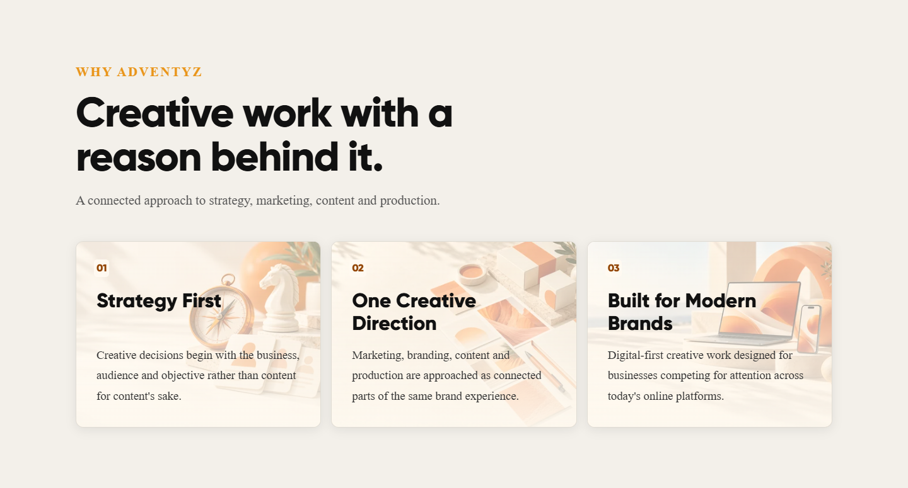
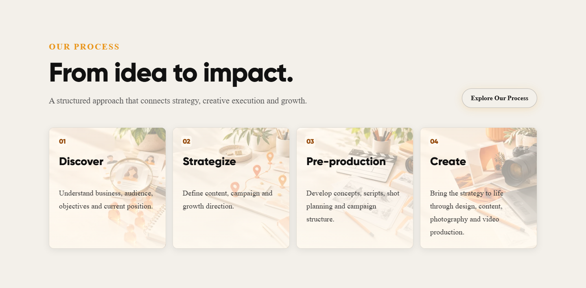
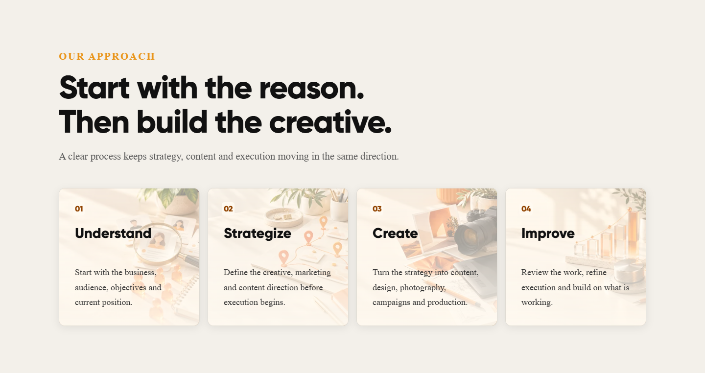
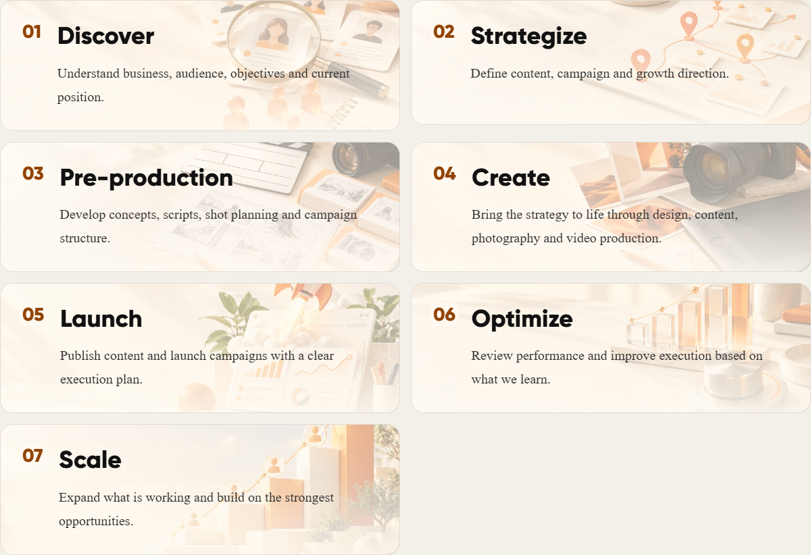
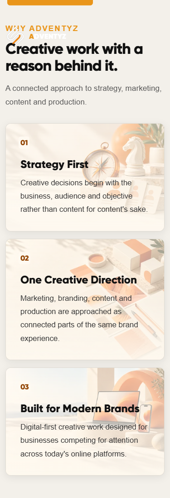

# Bright principle, approach and process artwork

## Scope

Added images to the 18 cards identified in the user's screenshots: three Home Why Adventyz cards, four Home process preview cards, four About approach cards and seven Process page cards. Existing card layout, copy, order, headings, interactions and reveal animations are retained. Prepared on `feat/light-process-card-images` from main commit `e42914958308ee0d4b6f22ff15275c3585ff6698`.

Ten original AI-generated images use high-key daylight, pale ivory surfaces and warm orange accents. There are no black backgrounds or dark scrims. Related steps reuse matching artwork to keep the story consistent and avoid duplicate image downloads.

| Artwork | Used for |
| --- | --- |
| Compass, chess knight and audience cards | Strategy First |
| Coordinated brand swatches and packaging | One Creative Direction |
| Laptop and phone brand interfaces | Built for Modern Brands |
| Magnifying glass and audience research | Discover / Understand |
| Connected planning cards and route markers | Strategize |
| Storyboards and film planning tools | Pre-production |
| Camera, drawing tablet and creative assets | Create |
| Orange rocket and campaign dashboard | Launch |
| Glass performance bars and adjustment dial | Optimize / Improve |
| Ascending blocks and audience nodes | Scale |

## Implementation

`src/data/lightCardImages.js` defines the local image URL pairs; `src/data/process.js` associates images with process steps. Home principles and About approach steps reuse the same map. `LightCardImage` renders an absolute decorative picture with empty alternative text, `aria-hidden`, native lazy loading, asynchronous decoding and responsive sources. It introduces no focusable elements or new runtime dependency. The absolute image layer cannot change card dimensions when it loads.

`src/styles/light-card-images.css` is scoped to `light-card` articles. A pale vertical wash protects dark headings and body copy while allowing the artwork to show through. Small numbers use a darker orange on a subtle ivory backplate for contrast. Images crop with `object-fit: cover` and a 65% horizontal focal point. The fallback surface is ivory.

All assets are 480×320 and 960×640 WebP files at quality 80. The ten small files total 128,682 bytes; the ten large files total 350,892 bytes. Individual files are approximately 10.8–16.6 KB small and 29.4–47.0 KB large. The browser chooses one source based on card size and pixel density; high-density phones may use the larger source. Original PNGs are not shipped. Replace both image sizes together and preserve the pale palette and right-biased subject composition.

## Validation — 14 October 2026

- Production build and lint passed.
- All eight existing contact validation and handoff tests passed.
- Chrome production-preview checks passed at 320, 375, 390, 430, 768, 1024 and 1440px on Home, About and Process: 21 route/width combinations, 126 card checks. Images decoded, decorative semantics were present, headings used dark text, card text stayed within bounds and pages had no horizontal overflow.
- No captured browser console errors or uncaught exceptions during those checks.
- Mobile Home process CTA navigation, direct page loads and Process refresh passed. Reduced-motion rendering and normal Process reveal rendering were checked.
- Contrast sampled conservatively across entire text bounding regions at 320, 390 and 1440px: 162 regions passed 4.5:1, minimum 4.90:1. Text was made transparent to measure the underlying backgrounds without removing backplates; fixed navigation/enquiry controls were excluded. This is a targeted check, not full accessibility certification.
- Mobile and desktop screenshots were visually inspected for crop, legibility and the requested light appearance. Section captures below hide unrelated fixed controls for review.
- `git diff --check` passed.

Performance checks cover compressed payload, responsive sources and lazy/async loading. No Lighthouse score or real-device/network benchmark is claimed. Testing used a local production preview. Other service cards and page styles were not edited. No merge or deployment was performed.

## Desktop previews

## Mobile preview

