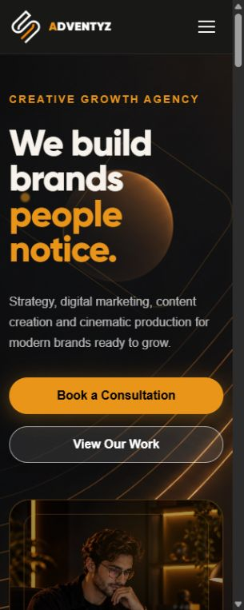
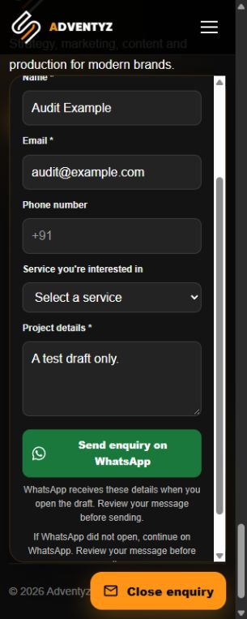
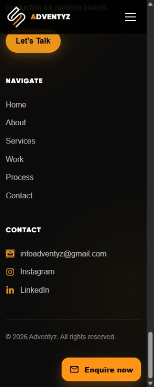

# Adventyz responsive audit — 11–12 October 2026

Audited the confirmed live site, https://adventyz1.netlify.app/, and repaired a local branch from latest `origin/main` (`cac90d08ddb0c35704ba866a7cfe2222232d353b`). Branch: `fix/mobile-responsiveness-audit`. Production was not edited, merged or deployed.

## Defects and repairs

| Defect / trigger | Targeted repair | Verification |
| --- | --- | --- |
| Home's desktop viewport height remained fixed after the layout stacked; the headline moved above the visible hero at tablet widths. | Auto height below 1025px; smaller mobile section padding. | All seven widths; headline remains below sticky header. |
| Hero image expanded into an oversized square in stacked layouts. | Explicit 420px tablet / 320px mobile visual height and removal of inherited image minimum height. | Image bounds and full-page review. |
| Selected-work placeholders created excessive blank space at 768px. | Cap mobile media height at 360px, retaining the existing aspect ratio and content. | Home at all widths. |
| Body's 320px minimum width overflowed when a classic scrollbar reduced available space. | Remove the body minimum width; retain mobile container gutters. | No horizontal overflow at 320px, including 15px scrollbar. |
| A later font reset overrode the configured reading font. | Restore the configured base font only on mobile/tablet. | Mobile readability; original desktop typography retained. |
| Header phone number overlapped Contact just above the mobile breakpoint. | Remove its horizontal translation only from 1025–1199px. | 1025, 1199, 1200, 1280, 1440 and 1920px header checks. |
| Mobile menu's close control was outside its keyboard trap; background remained interactive; resizing to desktop could leave scroll locked. | Add a close button inside the dialog, inert background, hide floating widget, close on desktop breakpoint, preserve overflow on cleanup. | Tab / Shift+Tab wrap, Escape, focus return, route navigation and desktop resize. |
| Floating enquiry covered the sticky header at 320px, had small close control and lacked initial focus / Escape restoration. | Bound panel with dynamic viewport height, 44px controls, focus management and 16px mobile inputs. | Panel top 97px below 71px header at 320×800; internal scrolling; Escape restores trigger. |
| Enquiry trigger obscured mobile copyright at page bottom. | Reserve 68px additional footer space while widget exists on small screens. | At 320×800 copyright bottom 708px, trigger top 739px. |
| WhatsApp enquiry accepted whitespace-only name/message and had no visible popup fallback. | Native validation plus whitespace rejection; encoded helper and explicit continuation link. | Validation, unit encoding tests, actual Adventyz share page with correct draft and number; no message sent. |
| 404 Contact button used black text on black background. | White text and border for that button, preserving layout and branding. | All seven widths and both 404 navigation buttons. |
| Several route introductions had no page-level heading. | Configurable SectionHeading tag; one h1 on every route; correct Services heading hierarchy. | Seven routes × seven widths. |
| Contact validation lacked accessible error associations and comprehensive bounds; a failed/slow endpoint could leave a poor retry experience. | Trimmed validation, known service allowlist, HTTP(S) website checks, length limits, first-error focus, associated errors, disabled pending fields, duplicate guard, 15s timeout and unmount abort. | Eight unit tests and local success / 503 / delayed response integration checks. |
| With no configured endpoint, the contact form could never deliver an enquiry. | User-confirmed `infoadventyz@gmail.com` email draft fallback, clearly requiring the visitor to send from their email app. Existing endpoint support retained. | Valid form produces correctly encoded mailto draft and focuses draft link; never claims it was sent. |
| Two PNG hero assets imposed unnecessary transfer cost. | Lossless WebP copies with identical decoded pixels; keep original sources. | Pixel comparison and production build; 928,929 bytes saved (29.3% of these two assets). |

## Breakpoint and visual results

PASS means direct route load, one main h1, no horizontal document overflow or out-of-bounds content, scroll-through visibility and full-page visual review. Browser viewport simulation used the Chromium-based Codex in-app browser, principally 800px viewport height. Width means verified `innerWidth`; classic scrollbars leave 15px less content space. This is not physical-device certification.

| Route | 320 | 375 | 390 | 430 | 768 | 1024 | 1440 |
| --- | --- | --- | --- | --- | --- | --- | --- |
| Home | PASS | PASS | PASS | PASS | PASS | PASS | PASS |
| About | PASS | PASS | PASS | PASS | PASS | PASS | PASS |
| Services | PASS | PASS | PASS | PASS | PASS | PASS | PASS |
| Work | PASS | PASS | PASS | PASS | PASS | PASS | PASS |
| Process | PASS | PASS | PASS | PASS | PASS | PASS | PASS |
| Contact | PASS | PASS | PASS | PASS | PASS | PASS | PASS |
| 404 (`/audit-not-found`) | PASS | PASS | PASS | PASS | PASS | PASS | PASS |

Reviewed every section's grid, text wrapping, image bounds, section spacing, sticky header, reveal visibility and CTA placement. Existing Work placeholders are intentional content; no portfolio projects were invented. Services, process steps and footer content remain present.

At 1440px, measured container sizes, headings, typography, line heights, padding and grid columns match an original-main production build on all seven routes. Animations make whole-page pixel equality unsuitable; this is measured layout comparison, not a claim of pixel-identical screenshots. Explicit desktop defect repairs are the 404 contrast and narrow 1025–1199px phone placement. Additional header checks at 1280/1920px preserve the wide desktop design.

## Functional checks

| Check | Result / method |
| --- | --- |
| Header and footer navigation | All six destinations clicked and matched expected URLs. |
| Home CTAs | Contact, Work, Services and Process destinations exercised. |
| 404 CTAs | Home and Contact links clicked successfully. |
| Direct URLs and refresh | Every route renders after direct navigation and explicit reload in local production preview. Live direct routes also render; SPA fallback remains in `public/_redirects`. |
| Mobile menu | Keyboard wrapping, Escape, focus return, inert background, route close and desktop resize verified. |
| Contact validation | Empty fields, whitespace, malformed email, invalid website scheme, known service, optional fields, length boundaries and error focus checked. Error IDs referenced by inputs. |
| Missing contact endpoint | Valid details prepare an email draft to the approved Gmail address; focus moves to draft link. No automatic email delivery is implied. |
| Local endpoint success | JSON payload trimmed; thanks state shown; keyboard focus moves to status. Fake test data only. |
| Local endpoint 503 | Friendly error shown, details retained and retry enabled. |
| Local delayed endpoint | Fields/submit disabled while pending; abort at 15s, values retained and retry enabled. |
| Enquiry panel | Open/close, first-field focus, Escape, whitespace validation, route reset, header/menu interaction and internal scrolling checked. |
| WhatsApp | Encoded recipient `918105579097` and draft verified on WhatsApp's Adventyz share page. No final send or app login performed. Continuation link available if popup is blocked. |
| Email / telephone / social links | Published mailto, tel, Instagram and LinkedIn destinations inspected; external links have noopener/noreferrer. Native mail/call launch and authenticated social content are not certified. |
| Console | No errors or warnings in local production route/refresh checks. Intentional mock 503 is a test failure response, not an application crash. |
| Reduced motion | Source inspection: Reveal/Header use `useReducedMotion`; CSS disables animations/transitions and smooth scrolling with `prefers-reduced-motion`. Actual OS preference emulation unavailable in this browser, so runtime reduced-motion verification remains manual. |

## Automated checks and performance

`npm test`: 8/8 passing. Covers validation and both handoff encoders, including Unicode, punctuation, line breaks and 10,000 repeated validations without mutation (about 13ms in final run; hardware-specific, not a load-service benchmark).

`npm run lint`, `npm run build` and `git diff --check`: passing. `npm audit`: zero reported vulnerabilities in installed dependencies at audit time. No production dependency was added.

Hero background: 1,429,145 → 1,047,282 bytes. Hero photo: 1,738,326 → 1,191,260 bytes. Same dimensions and identical decoded pixels. Current shared JS is about 406.98kB / 130.31kB gzip, with route chunks still split. The two hero images still total about 2.24MB; further lossy resizing/compression requires a separate visual-quality decision. No Lighthouse score, throttled mobile timing, Core Web Vitals field measurement or server-load claim is made.

## Evidence and review limitations

The delivered local report bundle includes 49 full-page screenshots, selected interaction screenshots, live-baseline measurements, breakpoint results, route-refresh results, navigation results and original-main desktop layout comparisons. Selected mobile evidence is included below for PR review.

Before approving release, inspect the PR preview on physical iOS Safari and Android Chrome, rotate the device, test the software keyboard and OS reduced-motion setting, and confirm native email draft / WhatsApp app opening. Native delivery is visitor-controlled and was not exercised. No backend exists in this repository; server-side validation, rate limiting, storage security, CSRF policy and delivery guarantees must be provided by any chosen endpoint. Client checks are not a security boundary. No live penetration or stress traffic was sent.

No merge or deployment was performed. Approval is required before those actions.
