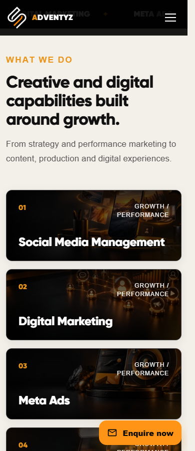
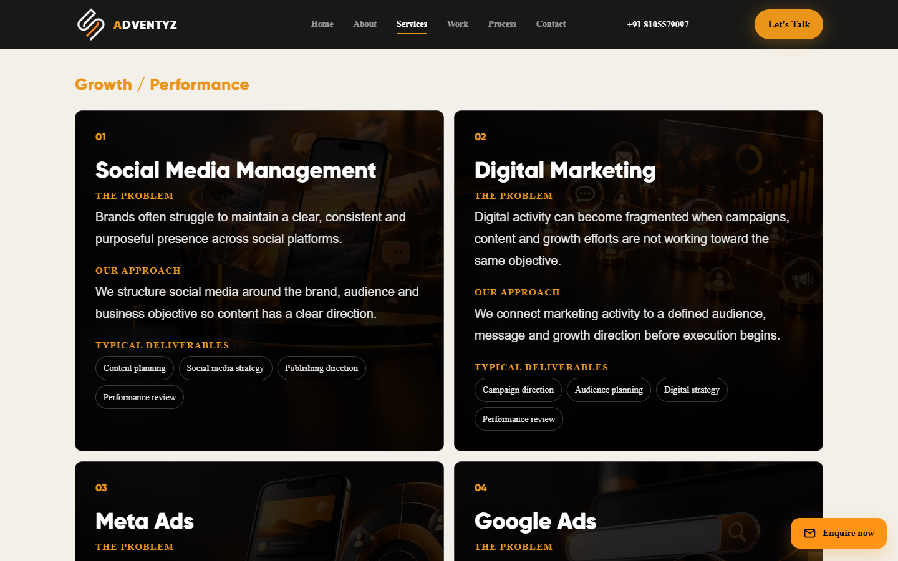

# Service card backgrounds

## Scope

Added original AI-generated orange/charcoal service artwork to the six existing Home preview cards and all nine Services cards. Started from main commit `764142cdb92f8d8a0ae659fb161a30ff6e37f3e6` on `feat/service-card-backgrounds`. Existing card dimensions, ordering, copy, motion, navigation and surrounding page styles are retained.

| Service | Image subject |
| --- | --- |
| Social Media Management | Smartphone with content tiles and conversation symbols |
| Digital Marketing | Campaign network and analytics dashboard |
| Meta Ads | Sponsored mobile creative and audience targeting rings |
| Google Ads | Search interface, magnifying glass and performance bars |
| Content Creation | Editorial storyboard, notebook and microphone |
| Cinematic Video Production | Cinema camera, slate and studio lighting |
| Photography | Still camera, prime lens and softbox |
| Website Development | Responsive laptop and phone interfaces |
| Branding & Creative Design | Packaging, stationery and orange swatches |

## Implementation and maintenance

`src/data/services.js` holds each service's two image URLs. Literal `new URL(..., import.meta.url)` expressions let Vite fingerprint the assets while keeping this shared data importable by the existing Node contact-validation tests. `ServiceCardImage` renders a decorative picture with empty alternative text and `aria-hidden`, responsive sources, native lazy loading and asynchronous decoding. Images introduce no focus targets or external image hosts. The fallback card surface is charcoal.

Artwork is stored locally in `src/assets/images/services/` as 480×320 and 960×640 WebP files, quality 78. All nine small images total 103,078 bytes; all nine large images total 289,386 bytes. Individual images range from 7,590–15,710 bytes at 480px and 23,240–43,306 bytes at 960px. Original generation PNGs are not shipped. Replace both sizes together, preserving the 3:2 aspect ratio and subject placement toward the upper right. The browser selects a source based on card width and device pixel ratio; high-density mobile displays can select 960px.

`service-card-images.css` scopes the dark theme to illustrated service cards. Images use `object-fit: cover` and a 65% horizontal focal point. Layered gradients protect white headings, light body text and orange labels; detailed Services copy uses a stronger scrim. Image layers are absolute, so image loading cannot change card dimensions. No new animation or runtime dependency was introduced.

## Validation — 14 October 2026

- `npm ci`: installed the lockfile dependencies; audit reported zero vulnerabilities.
- `npm run lint`: passed.
- `npm test`: all eight existing contact validation and handoff tests passed.
- `npm run build`: passed, including fingerprinted WebP assets.
- Production preview tested in headless Chrome at 320, 375, 390, 430, 768, 1024 and 1440px: 14 route/width combinations passed. Each card image decoded successfully, every card/text box stayed within bounds, headings resolved to white, decorative image semantics were present, and neither page had horizontal overflow.
- Browser console and uncaught-error capture reported zero errors during those checks.
- Mobile Home → Services CTA, direct Services load and reload passed. Reduced-motion rendering and the existing normal reveal animation were checked.
- Desktop and mobile screenshots were visually inspected for subject distinction, crop, legibility and card layout. Example screenshots are linked below. Some screenshot headings are above the viewport after scrolling to the cards; this is the existing sticky header behavior.
- Contrast measured over actual rendered image backgrounds at 320, 390 and 1440px across all cards: 351 text bounding regions passed a conservative 4.5:1 threshold; minimum measured ratio was 4.83:1. Text was temporarily hidden for background sampling, and unrelated fixed header/enquiry controls were excluded from these measurements. This is a targeted contrast check, not a full accessibility certification.
- `git diff --check`: passed.

Performance verification covers payload sizes, responsive sources, lazy/async loading and layout stability by construction. No Lighthouse score or real-device/network benchmark is claimed. Existing large hero images are outside this change. Browser testing used the local production preview; hosted routing and production infrastructure were not changed or tested.

